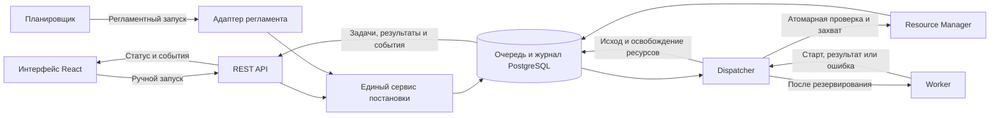

# Архитектура MVP оркестратора оценки рисков

RiskFlow — приложение с интерфейсом на React, REST API на FastAPI и хранилищем PostgreSQL. Ручные и регламентные заявки поступают в один сервис постановки. Диспетчер резервирует ресурсы, исполнитель выполняет расчёт, а интерфейс отображает статусы, результаты и историю. [Данные и процессы](business-analysis.md), [требования к поведению](requirements.md).

[Компоненты](#компоненты-системы) · [Расчётная дата](#расчётная-дата-регламентного-запуска) · [Job и Resource](#модель-job-и-resource) · [Жизненный цикл](#жизненный-цикл-задачи) · [Диспетчер](#диспетчер-и-резервирование) · [Worker](#контракт-dispatcher-и-worker) · [Повторные запуски](#повторные-запуски) · [REST API](#rest-api) · [Журнал событий](#журнал-событий)

## Компоненты системы

| Компонент | Назначение |
| --- | --- |
| Интерфейс React | Запуск расчётов, просмотр очереди, результатов и истории. FastAPI отдаёт собранный интерфейс по `/`. |
| REST API | Принимает ручные заявки и выдаёт данные о процессах, задачах и событиях. |
| Планировщик | Формирует заявки по расписанию и передаёт их в общий сервис постановки. |
| Сервис постановки | Определяет доступы по реестру процессов, сохраняет задачу и ставит её в очередь. |
| Диспетчер (`Dispatcher`) | Выбирает совместимые задачи, передаёт их исполнителю и фиксирует причину ожидания для остальных. |
| Менеджер ресурсов (`Resource Manager`) | Проверяет совместимость доступов, резервирует полный набор ресурсов и освобождает его при завершении. |
| Исполнитель (`Worker`) | Читает входные данные, выполняет расчёт и передаёт результат или ошибку ядру оркестратора. |
| PostgreSQL | Хранит реестр процессов, очередь, резервирования, события и результаты расчётов. |

## Путь задачи

При ручном запуске сервис постановки получает заявку через REST API. При регламентном запуске внутренний адаптер планировщика передаёт заявку тому же сервису. Источник сохраняется в задаче и используется в истории и при распознавании повторной доставки. Этапы резервирования, исполнения и публикации одинаковы для обоих источников. [FR-01](requirements.md#fr-01), [FR-05](requirements.md#fr-05), [FR-06](requirements.md#fr-06).

### Расчётная дата регламентного запуска

Для ежедневного и еженедельного расписания расчётная дата равна календарной дате запланированного срабатывания в `Europe/Moscow`. Одноразовый регламент может задать расчётную дату явно. Плановый момент сохраняется отдельно в `scheduledFor` в UTC. Обычный регламент доставляется в очередь в пределах пяти минут после планового момента, а более старое срабатывание записывается в историю со статусом `MISSED`.

## Модель Job и Resource

`Job` представляет отдельный запуск расчёта, `Resource` — набор данных, к которому обращаются процессы. Реестр процессов хранит идентификатор, название, шаблоны доступов и привязку к исполнителю. При постановке сервис вычисляет конкретные области по шаблонам и сохраняет их в `Job`. [FR-02](requirements.md#fr-02), [FR-10](requirements.md#fr-10).

| Поле | Смысл и правило |
| --- | --- |
| `jobId` | Уникальный идентификатор задачи. Её попытки и присоединённые заявки используют тот же идентификатор. |
| `processId`, `processVersion` | Идентификатор и версия процесса из серверного реестра, зафиксированные при постановке. |
| `calculationDate` | Календарная дата в формате `YYYY-MM-DD`, используется в дневных областях. Время исполнения хранится отдельно. |
| `trigger` | `type` из `MANUAL` и `SCHEDULED`, `initiatorId` из контекста пользователя или регламента. Для регламента также `scheduleId` и `scheduledFor` в UTC. |
| `queueSequence`, `queuedAt`, `priority` | Номер постановки, время приёма в UTC и исходный приоритет от 1 до 9. При равном эффективном приоритете диспетчер выбирает по номеру постановки. |
| `accesses` | Снимок полного набора `ResourceAccess` для задачи, включая входы и выходы. |
| `status`, `startedAt`, `finishedAt` | Состояние, подтверждённый старт текущей или последней попытки и время терминального перехода. При возврате в очередь на повтор `startedAt` очищается. После остановки уже стартовавшей задачи время старта сохраняется. |
| `attempt`, `retryAt`, `leaseUntil` | Номер попытки, ближайший момент её повторного выбора и срок действия текущего резервирования. `attempt` увеличивается при переходе в `STARTING`. |
| `waitReason` | Для `WAITING`. `code` принимает значения `RESOURCE_CONFLICT`, `QUEUE_FAIRNESS` или `NO_WORKER_SLOT`. При конфликте `conflicts[]` содержит `resourceKey`, область пересечения `scope`, `requestedMode`, `activeMode` и `blockingJobId`. Для `QUEUE_FAIRNESS` идентификатор указывает на ожидающую задачу впереди, а `activeMode` описывает её запрошенный доступ. |
| `result`, `error` | При успехе `result.outputs[]` содержит `resourceKey`, `scope`, `revision` и `value`. `result.inputVersions` описывает версии входов. При окончательной ошибке `error` содержит `code` и `message`. |
| `hasSnapshot`, `replayOf`, `batchId` | Признак снимка входов, ссылка на оригинал при воспроизведении и идентификатор серии расчётов, если задача входит в неё. |

### Resource и ResourceAccess

| Тип и поле | Смысл и правило |
| --- | --- |
| `Resource.resourceKey` | Канонический ключ логического набора данных. Один и тот же набор имеет один ключ во всех процессах. |
| `Resource.partitioning` | `BY_DATE` для изолированных разделов по датам или `GLOBAL` для единой области данных. |
| `Resource.kind` | Тип скопированного ресурса. При настройке процесса ресурсы связываются с входами и выходами совместимого типа. |
| `ResourceAccess.resourceKey` | Ссылка на `Resource`. |
| `ResourceAccess.scope` | `DATE` с полем `date` или `GLOBAL` для всей области ресурса. |
| `ResourceAccess.mode` | `READ` для чтения или `WRITE` для изменения. |

Шаблон `JOB_DATE` разворачивается в `DATE(calculationDate)`, а `GLOBAL` задаёт общую область. Режим и область наследуются от обработчика. При настройке процесса API проверяет, что каждый привязанный ресурс относится к типу, который ожидает обработчик.

Для одного `resourceKey` дневные области пересекаются при равенстве дат. `GLOBAL` пересекается с любой областью того же ключа, включая `GLOBAL`. Область пересечения пары `GLOBAL` и `DATE` — соответствующая дата. Для разных ключей пересечение пустое. В синтетической модели `risk_parameters` использует общую область. [Модель ресурсов](business-analysis.md), [матрица READ/WRITE](requirements.md#fr-03).

## Жизненный цикл задачи

Статус `STARTING` означает, что все ресурсы и место у исполнителя зарезервированы. Статус `RUNNING` появляется после подтверждения старта. Ядро фиксирует каждый переход вместе с событием в одной транзакции. [FR-04](requirements.md#fr-04), [FR-05](requirements.md#fr-05), [FR-07](requirements.md#fr-07), [FR-09](requirements.md#fr-09).

| Переход | Кто инициирует и при каком условии | Событие |
| --- | --- | --- |
| Создание → `QUEUED` | Сервис постановки принимает валидную новую заявку. | `JOB_QUEUED` |
| `QUEUED` → `WAITING` | Dispatcher обнаруживает конфликт ресурсов, приоритет защищённой ожидающей задачи или отсутствие места у исполнителя. | `JOB_WAITING` |
| `WAITING` → `WAITING` | Dispatcher пересчитывает причину и фиксирует её изменение. | `JOB_WAIT_REASON_CHANGED` |
| `QUEUED` или `WAITING` → `STARTING` | Dispatcher резервирует место и полный совместимый набор доступов. Причина ожидания очищается. | `JOB_RESERVED` |
| `STARTING` → `RUNNING` | Worker подтверждает готовность выполнить задачу, ядро фиксирует старт перед первым доступом к данным. | `JOB_STARTED` |
| `RUNNING` → `SUCCEEDED` | Worker передаёт результат, ядро публикует выход и завершает задачу. | `JOB_SUCCEEDED` |
| `STARTING` или `RUNNING` → `QUEUED` | При сбое, допускающем повтор, ядро освобождает ресурсы и назначает время следующей попытки. `jobId` и номер постановки сохраняются. | `JOB_RETRY_SCHEDULED` |
| `STARTING` или `RUNNING` → `FAILED` | Ядро фиксирует невосстанавливаемую ошибку либо исчерпание попыток. Резервирования освобождаются. | `JOB_FAILED` |
| `QUEUED` или `WAITING` → `CANCELLED` | `/cancel` снимает ожидающую задачу с выбора. `/stop` также доступен для ожидающей задачи. | `JOB_CANCELLED` |
| `STARTING` или `RUNNING` → `CANCELLED` | `/stop` переводит активную задачу в терминальное состояние и освобождает логические резервирования. Публикация результата остановленной попыткой отклоняется. | `JOB_CANCELLED` |

`SUCCEEDED`, `FAILED` и `CANCELLED` — терминальные состояния. Задачи в `STARTING` и `RUNNING` удерживают резервирования, включая место у исполнителя. Задачи в `QUEUED` и `WAITING` ждут без резервирований. Если отмена и резервирование происходят одновременно, действует переход, первым зафиксированный в хранилище.

## Диспетчер и резервирование

Менеджер ресурсов выделяет весь набор доступов одной операцией. При свободном месте у исполнителя диспетчер может запустить совместимую задачу, пока другая задача ждёт ресурс. [FR-03](requirements.md#fr-03), [FR-04](requirements.md#fr-04), [NFR-01](requirements.md#nfr-01).

Алгоритм рассчитан на один экземпляр серверной части с локальными исполнителями и PostgreSQL.

1. Приём новой задачи, завершение или отмена будят диспетчер. Периодический проход также проверяет сроки резервирований и повторных попыток. Кандидаты в `QUEUED` и `WAITING` с наступившим `retryAt` или без него упорядочиваются по эффективному приоритету, затем по `queueSequence`. Исходный приоритет по умолчанию равен 5. Каждые 30 секунд ожидания уменьшают числовое значение приоритета на 1, до минимума 1. Меньшее значение даёт преимущество.
2. Для каждого кандидата сначала проверяется конфликт с активными резервированиями (`RESOURCE_CONFLICT`), затем с защищёнными задачами впереди (`QUEUE_FAIRNESS`), затем наличие свободного места (`NO_WORKER_SLOT`). Задача, ожидающая не менее четырёх минут, может защитить свой набор доступов от последующих несовместимых кандидатов. Ожидающая задача при этом удерживает ноль резервирований.
3. Диспетчер пропускает заблокированных кандидатов и при свободном месте выбирает первого совместимого в этом порядке. После каждого захвата он повторно проверяет кандидатов с учётом нового набора активных задач.
4. Для проверки и изменения состояния ядро берёт блокировку одной управляющей строки PostgreSQL внутри короткой транзакции. Под ней оно повторно читает состояния кандидатов и активные резервирования. Захват всего набора, учёт места, переход в `STARTING` и запись `JOB_RESERVED` фиксируются вместе. Тем же порядком сериализуются отмена и завершение. Это закрывает гонку двух проверок при пустом реестре резервирований.
5. Задача передаётся Worker после фиксации транзакции. Блокировка строки PostgreSQL к этому моменту снята. Логические резервирования действуют в `STARTING` и `RUNNING`, после чего исчезают при терминальном переходе или возврате в очередь на повтор. Dispatcher продолжает выбирать задачи для оставшихся мест. Размер пула настраивается, для параллельного запуска нужны минимум два места.

## Контракт Dispatcher и Worker

Диспетчер и Worker обмениваются сообщениями внутри серверного процесса. Worker отдельно подтверждает старт и сообщает исход выполнения. [FR-05](requirements.md#fr-05), [FR-08](requirements.md#fr-08), [NFR-01](requirements.md#nfr-01).

| Сообщение | Кто передаёт | Состав и эффект |
| --- | --- | --- |
| `StartJob` | Dispatcher → Worker | `jobId`, внутренний `executionId`, `processId`, `calculationDate` и зафиксированный набор `accesses`. `executionId` создаётся при резервировании и связывает ответы с конкретным исполнением. Worker принимает каждый `executionId` к исполнению один раз. |
| `Started` | Worker → ядро оркестратора | `jobId`, `executionId`. Подтверждение перехода в `RUNNING` разрешает Worker начать чтение из объявленных областей. Повтор запроса не создаёт второго старта или второго исполнения. |
| `Completed` | Worker → ядро оркестратора | `jobId`, `executionId`, подготовленные выходные значения и версии входов. Ядро сверяет ключи с набором `WRITE`, берёт области из сохранённых доступов задачи и публикует результат. |
| `Failed` | Worker → ядро оркестратора | `jobId`, `executionId`, `error.code`, `error.message`. Примеры кодов — `INPUT_NOT_FOUND` для отсутствующего входа и `EXECUTION_ERROR` для ошибки расчёта. Worker отправляет исход после прекращения доступов к данным. |

Worker читает объявленные входы, сохраняет снимок входных значений и версий и передаёт расчёт локальному дочернему процессу. При обычном `Completed` ядро публикует выходы, сохраняет результат, переводит задачу в `SUCCEEDED`, освобождает ресурсы и записывает событие в одной транзакции. При ошибке ядро в одной транзакции освобождает ресурсы, записывает причину и либо возвращает задачу в очередь, либо завершает её. После фиксации диспетчер повторно проверяет очередь.

Отказ передачи до старта (`DISPATCH_ERROR`), обрыв связи (`WORKER_LOST`), истечение резервирования (`LEASE_EXPIRED`) и прерванное исполнение (`EXECUTION_INTERRUPTED`) допускают до трёх попыток всего. Паузы перед повторами составляют 1 и 2 секунды. Повтор использует сохранённый снимок входов, если тот успел записаться. Ошибки расчёта или публикации, включая `INPUT_NOT_FOUND` и `RESULT_WRITE_ERROR`, сразу переводят задачу в `FAILED`. Откат публикации сохраняет предыдущие выходные значения.

При резервировании ядро выдаёт новый `executionId` и срок действия 15 секунд. Worker продлевает срок во время расчёта. Публикация требует актуального идентификатора попытки, статуса `RUNNING` и действующего срока резервирования. Повтор сообщения о завершённой, остановленной или заменённой попытке не меняет данные и журнал. После перезапуска сервер проверяет сохранённые `STARTING` и `RUNNING` и применяет к ним правило `EXECUTION_INTERRUPTED`.

## Повторные запуски

При обычной постановке ручной ключ доставки состоит из `MANUAL`, `initiatorId` и `Idempotency-Key`. Для регламента используются `SCHEDULED`, `scheduleId` и `scheduledFor`. Ключ, параметры заявки и `jobId` связываются атомарно. Повтор с совпадающими параметрами возвращает текущий статус прежней задачи. Тот же ключ с другими параметрами даёт `409`. При выключенном `joinActive` новая заявка получает новый `jobId`. [FR-10](requirements.md#fr-10).

`joinActive` — опция процесса, выключенная по умолчанию. При её включении обычная заявка может присоединиться к незавершённой задаче того же процесса, даты, версии, приоритета и типа запуска (`MANUAL` или `SCHEDULED`). Исходный `trigger` остаётся у задачи, а данные новой заявки записываются в `JOB_TRIGGER_JOINED`. Явный перезапуск, демонстрационные заявки и заявки серии обходят объединение.

`/restart` создаёт новую задачу для того же процесса и даты по текущей версии процесса. Она читает актуальные входы при старте и публикует новый результат. `/replay` создаёт отдельную задачу с сохранённым снимком входов и ссылкой `replayOf` на оригинал. Для воспроизведения нужна версия обработчика, указанная в снимке. Система сверяет выходы с оригиналом и сохраняет результат в истории новой задачи без изменения текущих значений ресурсов. Повтор `/replay` с тем же `Idempotency-Key`, инициатором и исходной задачей возвращает существующую задачу с кодом `200`. Если тот же инициатор использует ключ для другой исходной задачи, API возвращает `409`.

## REST API

Маршруты приложения используют префикс `/api/v1`. FastAPI публикует схему по `/openapi.json`. Тест контракта сравнивает её со снимком в репозитории. [Снимок OpenAPI](openapi.json), [OpenAPI локального стенда](http://127.0.0.1:8000/openapi.json), [FR-06](requirements.md#fr-06), [FR-07](requirements.md#fr-07), [FR-09](requirements.md#fr-09).

| Операция | Маршрут относительно `/api/v1` | Вход и наблюдаемый ответ |
| --- | --- | --- |
| Список процессов | `GET /processes` | `processId` и название для формы запуска. |
| Ручной запуск | `POST /jobs` | Тело с `processId`, `calculationDate` и необязательным `priority`, опциональный `Idempotency-Key`. `201` с `jobId`, статусом и `queuedAt` для новой задачи, `200` для повтора доставки или присоединения. |
| Очередь и список задач | `GET /jobs` | Параметр `view` выбирает очередь, активные задачи или историю. Фильтры принимают статус, процесс, расчётную дату и тип запуска. Очередь и активные задачи идут по возрастанию `queueSequence`, история — по убыванию. |
| Детали и итог | `GET /jobs/{jobId}` | `Job`, включая область доступа, ожидание, времена и применимые `result` или `error`. |
| История и общий таймлайн | `GET /events` | Необязательный фильтр по `jobId` и курсор `afterEventId`. Возвращает события в возрастающем порядке `eventId`. |
| Отмена до резервирования | `POST /jobs/{jobId}/cancel` | `200` с `jobId` и `CANCELLED` при успешной отмене. `409` при состоянии, в котором отмена недоступна. |
| Остановка | `POST /jobs/{jobId}/stop` | `200` с `jobId` и `CANCELLED` для остановленной задачи. `409` для уже завершённой расчётом задачи. |
| Новый расчёт | `POST /jobs/{jobId}/restart` | Создаёт новую задачу для завершённого запуска с актуальной версией процесса. |
| Воспроизведение | `POST /jobs/{jobId}/replay` | `201` с новой задачей на основе сохранённого снимка входов завершённого расчёта, `200` при повторной доставке. |
| Демонстрация конфликта | `POST /demo`, `GET /demo/{demoId}` | Запуск трёх расчётов в отдельной схеме PostgreSQL и чтение их статусов и результатов. |

Обработчики ошибок API возвращают `code` и `message`. Код `422` используется, в частности, для неизвестного процесса и недопустимой даты, `404` — для неизвестной задачи, `409` — для конфликта состояния или повтора ключа с другими параметрами. Ошибка расчёта доступна в `Job.error`.

`initiatorId` задаётся конфигурацией в локальном режиме и берётся из контекста аутентификации в режиме доверенного прокси. Список задач и события возвращаются страницами до 200 записей. Самостоятельные задачи по расписанию видны с источником `SCHEDULED`.

## Журнал событий

Система записывает событие при изменении статуса или причины ожидания. Событие содержит `eventId` для общего порядка, `jobId`, `type`, `occurredAt` в UTC, `status` после перехода и `payload`. Ядро выдаёт `eventId` внутри транзакции изменения состояния, чтобы порядок выдачи по курсору совпадал с порядком зафиксированных переходов. [FR-07](requirements.md#fr-07), [NFR-02](requirements.md#nfr-02), [критерии приёмки](requirements.md).

| Событие | Данные `payload` для UI и тестов |
| --- | --- |
| `JOB_QUEUED` | Для обычной постановки `processId`, `calculationDate`, `trigger`, `queueSequence`. Для воспроизведения `replayOf`. `occurredAt` совпадает с `Job.queuedAt`. |
| `JOB_TRIGGER_JOINED` | `trigger` новой заявки, присоединившейся к существующей задаче. |
| `JOB_WAITING`, `JOB_WAIT_REASON_CHANGED` | Актуальный `waitReason` с причиной и блокирующими задачами. |
| `JOB_RESERVED` | `attempt` и `reservedAccesses` — номер попытки и весь её набор ресурсов. |
| `JOB_STARTED` | Подтверждённый старт Worker. Время события равно `Job.startedAt`. |
| `JOB_SUCCEEDED` | `releasedAccesses`. Результат доступен через карточку `jobId` из события. `occurredAt` совпадает с `Job.finishedAt`. |
| `JOB_FAILED` | `releasedAccesses`, `error.code`, `error.message`. `occurredAt` совпадает с `Job.finishedAt`. |
| `JOB_RETRY_SCHEDULED` | `attempt` завершённой попытки, `error`, `retryAt` и `releasedAccesses`. |
| `JOB_CANCELLED` | `initiatorId`. При остановке также `releasedAccesses`. `occurredAt` совпадает с `Job.finishedAt`. |

Порядок проверяется по `eventId` внутри одной очереди. Для каждой попытки интервал резервирования начинается в `JOB_RESERVED` и заканчивается на `JOB_SUCCEEDED`, `JOB_FAILED`, `JOB_RETRY_SCHEDULED` или `JOB_CANCELLED` с освобождёнными доступами. Фактическое исполнение начинается в `JOB_STARTED`, если попытка дошла до старта. Следующее несовместимое резервирование допустимо после освобождения предыдущего. API возвращает время в UTC.

## Демонстрационный стенд

Из корня проекта запустите `./scripts/start-local.sh` при работающем Docker с Compose. Скрипт создаёт локальный `.env` при первом запуске, собирает бэкенд и интерфейс и ждёт готовности API. История сохраняется в томе PostgreSQL. [Панель RiskFlow](http://127.0.0.1:8000/), [Swagger UI](http://127.0.0.1:8000/docs), [разработка интерфейса](../frontend/README.md).

В панели откройте «Демо конкуренции» и нажмите «Запустить демонстрацию». На таймлайне плановый кредитный расчёт ждёт освобождения ресурса ручным кредитным расчётом, а расчёт ликвидности выполняется параллельно. Для той же проверки через API доступны `POST /api/v1/demo`, `GET /api/v1/demo/{batch_id}` и `GET /api/v1/events?jobId=…`. [Критерии приёмки](requirements.md#критерии-приёмки).

`python3 scripts/smoke_backend.py` проверяет ручной расчёт и повтор доставки, а флаг `--demo` проверяет порядок событий трёх задач. Для сравнения алгоритмов очереди запустите `docker compose exec backend python -m backend.analytics.benchmark`. Результаты эксперимента доступны в `GET /api/v1/benchmarks`.

Для интеграционных тестов в окружении Python 3.12 установите `requirements-test.txt`, укажите `TEST_DATABASE_URL` для отдельной базы PostgreSQL и запустите `python -m pytest tests/ -q`. Роль должна иметь право создавать схемы. При установленном `pgserver` тесты также могут запустить временную базу локально.
