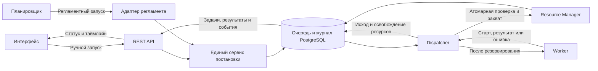

# Архитектура MVP оркестратора оценки рисков

Проект MVP описывает модульное веб-приложение с REST API на FastAPI и хранилищем PostgreSQL. Ручные и регламентные заявки поступают в один сервис постановки. Диспетчер резервирует ресурсы, исполнитель выполняет расчёт, а интерфейс получает статусы, результаты и историю из API. [Данные и процессы](business-analysis.md), [требования к поведению](requirements.md).

[Компоненты](#компоненты-системы) · [Расчётная дата](#расчётная-дата-регламентного-запуска) · [Job и Resource](#модель-job-и-resource) · [Жизненный цикл](#жизненный-цикл-задачи) · [Диспетчер](#диспетчер-и-резервирование) · [Worker](#контракт-dispatcher-и-worker) · [Повторные запуски](#повторные-запуски) · [REST API](#rest-api) · [Журнал событий](#журнал-событий)

## Компоненты системы

| Компонент | Назначение |
| --- | --- |
| Веб-интерфейс | Запуск расчётов, просмотр очереди, причин ожидания, результатов, ошибок и истории. |
| REST API | Принимает ручные заявки и выдаёт данные о процессах, задачах и событиях. |
| Планировщик | Формирует заявки по расписанию и передаёт их в общий сервис постановки. |
| Сервис постановки | Определяет доступы по реестру процессов, сохраняет задачу и ставит её в очередь. |
| Диспетчер (`Dispatcher`) | Выбирает совместимые задачи, передаёт их исполнителю и фиксирует причину ожидания для остальных. |
| Менеджер ресурсов (`Resource Manager`) | Проверяет совместимость доступов, резервирует полный набор ресурсов и освобождает его при завершении. |
| Исполнитель (`Worker`) | Читает входные данные, выполняет расчёт и передаёт результат или ошибку ядру оркестратора. |
| PostgreSQL | Хранит реестр процессов, очередь, резервирования, события и результаты расчётов. |

## Путь задачи

При ручном запуске сервис постановки получает заявку через REST API. При регламентном запуске внутренний адаптер планировщика передаёт заявку тому же сервису. Источник сохраняется в задаче и используется в истории и при распознавании повторной доставки. Этапы резервирования, исполнения и публикации одинаковы для обоих источников. [FR-01](requirements.md#fr-01), [FR-05](requirements.md#fr-05), [FR-06](requirements.md#fr-06).

### Расчётная дата регламентного запуска

По предлагаемому правилу расчётная дата равна календарной дате срабатывания в часовой зоне регламента. Момент срабатывания сохраняется отдельно в `scheduledFor` в UTC.

## Модель Job и Resource

`Job` представляет отдельный запуск расчёта, `Resource` — набор данных, к которому обращаются процессы. Реестр процессов хранит идентификатор, название, шаблоны доступов и привязку к исполнителю. При постановке сервис вычисляет конкретные области по шаблонам и сохраняет их в `Job`. [FR-02](requirements.md#fr-02), [FR-10](requirements.md#fr-10).

| Поле | Смысл и правило |
| --- | --- |
| `jobId` | Уникальный идентификатор одного запуска, сохраняется на всём его жизненном цикле. |
| `processId` | Идентификатор процесса из серверного реестра. |
| `calculationDate` | Календарная дата в формате `YYYY-MM-DD`, используется в дневных областях. Время исполнения хранится отдельно. |
| `trigger` | `type` из `MANUAL` и `SCHEDULED`, `initiatorId` из контекста пользователя или регламента. Для регламента также `scheduleId` и `scheduledFor` в UTC. |
| `queueSequence`, `queuedAt` | Возрастающий номер постановки и время приёма в UTC. Номер определяет порядок при выборе совместимых задач. |
| `accesses` | Снимок полного набора `ResourceAccess` для задачи, включая входы и выходы. |
| `status`, `startedAt`, `finishedAt` | Текущее состояние, время подтверждённого старта Worker и время терминального перехода. Время старта отсутствует у отменённых и завершившихся до старта задач. |
| `waitReason` | Только для `WAITING`. `code` равен `RESOURCE_CONFLICT` или `NO_WORKER_SLOT`. Для конфликта `conflicts[]` содержит `resourceKey`, область пересечения `scope`, `requestedMode`, `activeMode` и `blockingJobId` для каждой конфликтующей пары. |
| `result`, `error` | При успехе `result.outputs[]` содержит `resourceKey`, `scope` и сохранённое `value`. При ошибке `error` содержит стабильный `code` и сообщение `message` для пользователя. У каждого терминального исхода заполнены только применимые поля. |

### Resource и ResourceAccess

| Тип и поле | Смысл и правило |
| --- | --- |
| `Resource.resourceKey` | Канонический ключ логического набора данных. Один и тот же набор имеет один ключ во всех процессах. |
| `Resource.description` | Назначение ресурса, пригодное для реестра и интерфейса. |
| `Resource.partitioning` | `BY_DATE` для изолированных разделов по датам или `GLOBAL` для единой области данных. |
| `ResourceAccess.resourceKey` | Ссылка на `Resource`. |
| `ResourceAccess.scope` | `DATE` с полем `date` или `GLOBAL` для всей области ресурса. |
| `ResourceAccess.mode` | `READ` для чтения или `WRITE` для изменения. При чтении и записи одной и той же области фиксируется `WRITE`. |

Шаблон `JOB_DATE` разворачивается в `DATE(calculationDate)`, только если ресурс разделён по датам и весь доступ изолирован внутри раздела. Шаблон `GLOBAL` разворачивается в общую область и обязателен для общего ресурса. Он также применяется к разделённому ресурсу, если операция затрагивает его целиком. Шаблон с неизвестным ключом или дневным доступом к общему ресурсу отклоняется при проверке реестра. Режимы и области назначает сервер.

Для одного `resourceKey` дневные области пересекаются при равенстве дат. `GLOBAL` пересекается с любой областью того же ключа, включая `GLOBAL`. Область пересечения пары `GLOBAL` и `DATE` — соответствующая дата. Для разных ключей пересечение пустое. В синтетической модели `risk_parameters` использует общую область. [Модель ресурсов](business-analysis.md), [матрица READ/WRITE](requirements.md#fr-03).

## Жизненный цикл задачи

Статус `STARTING` означает, что все ресурсы и место у исполнителя зарезервированы. Статус `RUNNING` появляется после подтверждения старта. Ядро фиксирует каждый переход вместе с событием в одной транзакции. [FR-04](requirements.md#fr-04), [FR-05](requirements.md#fr-05), [FR-07](requirements.md#fr-07), [FR-09](requirements.md#fr-09).

| Переход | Кто инициирует и при каком условии | Событие |
| --- | --- | --- |
| Создание → `QUEUED` | Сервис постановки принимает валидную новую заявку. | `JOB_QUEUED` |
| `QUEUED` → `WAITING` | Dispatcher обнаруживает конфликт ресурсов или отсутствие места у исполнителя. При наличии обоих условий фиксируется конфликт ресурсов. | `JOB_WAITING` |
| `WAITING` → `WAITING` | Dispatcher пересчитывает причину и фиксирует её изменение. | `JOB_WAIT_REASON_CHANGED` |
| `QUEUED` или `WAITING` → `STARTING` | Dispatcher резервирует место и полный совместимый набор доступов. Причина ожидания очищается. | `JOB_RESERVED` |
| `STARTING` → `RUNNING` | Worker подтверждает готовность выполнить задачу, ядро фиксирует старт перед первым доступом к данным. | `JOB_STARTED` |
| `RUNNING` → `SUCCEEDED` | Worker передаёт результат, ядро публикует выход и завершает задачу. | `JOB_SUCCEEDED` |
| `STARTING` или `RUNNING` → `FAILED` | Dispatcher фиксирует отказ передачи до принятия Worker либо Worker сообщает об ошибке после старта. Ошибка публикации также завершает работу с `FAILED`. | `JOB_FAILED` |
| `QUEUED` или `WAITING` → `CANCELLED` | API передаёт запрос отмены, ядро проверяет статус и снимает задачу с выбора. Причина ожидания очищается. | `JOB_CANCELLED` |

`SUCCEEDED`, `FAILED` и `CANCELLED` — терминальные состояния. Задачи в `STARTING` и `RUNNING` удерживают резервирования, включая место у исполнителя. Задачи в `QUEUED` и `WAITING` ждут без резервирований. Если отмена и резервирование происходят одновременно, действует переход, первым зафиксированный в хранилище.

## Диспетчер и резервирование

Менеджер ресурсов выделяет весь набор доступов одной операцией. При свободном месте у исполнителя диспетчер может запустить совместимую задачу, пока другая задача ждёт ресурс. [FR-03](requirements.md#fr-03), [FR-04](requirements.md#fr-04), [NFR-01](requirements.md#nfr-01).

Алгоритм рассчитан на один экземпляр серверной части с локальными исполнителями и PostgreSQL.

1. Приём новой задачи, завершение с освобождением ресурсов или отмена будят цикл диспетчера после фиксации транзакции. Новый проход повторно проверяет `QUEUED` и `WAITING` по `queueSequence`. Если сигнал поступает во время прохода, диспетчер выполняет следующий проход перед ожиданием.
2. Для каждой задачи диспетчер сверяет доступы с действующими резервированиями. Конфликтующие задачи получают или обновляют причину `RESOURCE_CONFLICT`. Если конфликтов нет и все места заняты, фиксируется `NO_WORKER_SLOT`.
3. При свободном месте выбирается самая ранняя из совместимых задач. Заблокированные кандидаты сохраняют номер очереди. После каждого резервирования проход повторяет проверку с начала упорядоченного списка. Это обновляет и выбор, и причины ожидания с учётом нового активного набора. При постоянном потоке совместимых с активными задачами заявок время ожидания более раннего кандидата может расти, если новые запуски занимают ресурсы из его набора или все места исполнителя.
4. Для проверки и изменения состояния ядро берёт блокировку одной управляющей строки PostgreSQL внутри короткой транзакции. Под ней оно повторно читает состояния кандидатов и активные резервирования. Захват всего набора, учёт места, переход в `STARTING` и запись `JOB_RESERVED` фиксируются вместе. Тем же порядком сериализуются отмена и завершение. Это закрывает гонку двух проверок при пустом реестре резервирований.
5. Задача передаётся Worker после фиксации транзакции. Физическая блокировка строки PostgreSQL к этому моменту снята, а логические резервирования в таблице действуют до терминального перехода. Dispatcher продолжает выбирать задачи для оставшихся мест. Размер пула настраивается, для проверок параллельности нужны минимум два места.

## Контракт Dispatcher и Worker

Диспетчер и Worker обмениваются сообщениями внутри серверного процесса. Worker отдельно подтверждает старт и сообщает исход выполнения. [FR-05](requirements.md#fr-05), [FR-08](requirements.md#fr-08), [NFR-01](requirements.md#nfr-01).

| Сообщение | Кто передаёт | Состав и эффект |
| --- | --- | --- |
| `StartJob` | Dispatcher → Worker | `jobId`, внутренний `executionId`, `processId`, `calculationDate` и зафиксированный набор `accesses`. `executionId` создаётся при резервировании и связывает ответы с конкретным исполнением. Worker принимает каждый `executionId` к исполнению один раз. |
| `Started` | Worker → ядро оркестратора | `jobId`, `executionId`. Подтверждение перехода в `RUNNING` разрешает Worker начать чтение из объявленных областей. Повтор запроса не создаёт второго старта или второго исполнения. |
| `Completed` | Worker → ядро оркестратора | `jobId`, `executionId`, полный набор подготовленных выходов `outputs[]` с ключом, областью и значением. Ядро проверяет соответствие объявленным `WRITE` и публикует результат. |
| `Failed` | Worker → ядро оркестратора | `jobId`, `executionId`, `error.code`, `error.message`. Примеры кодов — `INPUT_NOT_FOUND` для отсутствующего входа и `EXECUTION_ERROR` для ошибки расчёта. Worker отправляет исход после прекращения доступов к данным. |

Worker читает объявленные входы и готовит результат. Синтетические выходы и состояние ядра хранятся в одном PostgreSQL. При `Completed` ядро выполняет запись выходов, сохранение снимка результата, переход в `SUCCEEDED`, освобождение всех доступов и места и запись события в одной транзакции. При `Failed` ядро в одной транзакции сохраняет ошибку, переводит задачу в `FAILED`, освобождает набор и место и записывает событие. После фиксации оно будит диспетчер.

Если транзакция публикации откатилась, ядро фиксирует `RESULT_WRITE_ERROR` отдельной транзакцией и сохраняет прежние опубликованные значения. При неопределённом исходе сначала проверяется сохранённый статус. Если передача Worker подтверждённо сорвалась до принятия, ядро завершает `STARTING` с `DISPATCH_ERROR`. При неопределённом исходе передачи ресурсы удерживаются до подтверждения, что Worker закончил доступы или запуск не начался. По `jobId` и `executionId` ядро проверяет отправителя исхода и допустимый переход. Повтор подтверждённого исхода возвращает уже сохранённый результат обработки без нового изменения данных или журнала.

При аварийной остановке серверного процесса резервирования сохраняются в PostgreSQL. Автоматическое восстановление этих задач находится за границами текущего прототипа.

## Повторные запуски

В предлагаемой модели намеренная повторная заявка получает новый `jobId` и обычное место в очереди. Для ручного запроса веб-интерфейс формирует новый `Idempotency-Key` на каждое действие запуска и сохраняет его при повторной передаче этого действия. При переданном ключе область уникальности — `MANUAL`, `initiatorId` и ключ. Для регламента идентификатор доставки — `SCHEDULED`, `scheduleId` и `scheduledFor`. Ключ, параметры заявки и `jobId` связываются атомарно при постановке.

Совпадение ключа и серверных параметров постановки, включая процесс и расчётную дату, возвращает существующий `jobId` и текущий статус. Совпадение ключа при других параметрах возвращает конфликт. Ручной запрос без ключа обрабатывается как новая заявка. При успехе новый результат публикуется в ту же объявленную область, а прежние снимки результата остаются доступны по прежним `jobId`. [FR-10](requirements.md#fr-10).

## REST API

Веб-интерфейс использует REST API для постановки задач, просмотра очереди и истории. В таблице приведены проектные маршруты, поля и коды ответов. Спецификация OpenAPI пока отсутствует. [FR-01](requirements.md#fr-01), [FR-06](requirements.md#fr-06), [FR-07](requirements.md#fr-07), [FR-09](requirements.md#fr-09).

| Операция | Предлагаемый маршрут | Вход и наблюдаемый ответ |
| --- | --- | --- |
| Список процессов | `GET /processes` | `processId` и название для формы запуска. |
| Ручной запуск | `POST /jobs` | Тело с `processId` и `calculationDate`, опциональный заголовок `Idempotency-Key`. `201` с `jobId`, статусом и `queuedAt` для новой заявки, `200` для совпавшего повтора. |
| Очередь и список задач | `GET /jobs` | Фильтры по статусу, процессу, расчётной дате и источнику запуска. Возвращает поля `Job`, нужные для списка, включая `waitReason`. В очереди порядок по возрастанию `queueSequence`. |
| Детали и итог | `GET /jobs/{jobId}` | `Job`, включая область доступа, ожидание, времена и применимые `result` или `error`. |
| История и общий таймлайн | `GET /events` | Необязательный фильтр по `jobId` и курсор `afterEventId`. Возвращает события в возрастающем порядке `eventId`. |
| Отмена до резервирования | `POST /jobs/{jobId}/cancel` | `200` с `jobId` и `CANCELLED` при успешной отмене. `409` при состоянии, в котором отмена недоступна. |

Ошибки API содержат `code`, `message` и при необходимости `details`. Код `422` означает неизвестный процесс или недопустимую дату, `404` — неизвестную задачу, `409` — конфликт состояния или повторный ключ с другими параметрами. Ошибка расчёта доступна в `Job.error`.

Для обновления статусов и истории предлагается периодический опрос API (polling). При недоступном API интерфейс показывает последнее известное состояние задачи и отмечает, что данные могли устареть. Источник `initiatorId`, интервал опроса и ограничения пагинации остаются открытыми параметрами контракта. Задачи по расписанию появляются в списке с источником `SCHEDULED`.

## Журнал событий

Система записывает событие при изменении статуса или причины ожидания. Событие содержит `eventId` для общего порядка, `jobId`, `type`, `occurredAt` в UTC, `status` после перехода и `payload`. Ядро выдаёт `eventId` внутри транзакции изменения состояния, чтобы порядок выдачи по курсору совпадал с порядком зафиксированных переходов. [FR-07](requirements.md#fr-07), [NFR-02](requirements.md#nfr-02), [критерии приёмки](requirements.md).

| Событие | Данные `payload` для UI и тестов |
| --- | --- |
| `JOB_QUEUED` | `processId`, `calculationDate`, `trigger`, `queueSequence`. `occurredAt` совпадает с `Job.queuedAt`. |
| `JOB_WAITING`, `JOB_WAIT_REASON_CHANGED` | Актуальный `waitReason` с причиной и блокирующими задачами. |
| `JOB_RESERVED` | `reservedAccesses` — весь набор, выделенный задаче. |
| `JOB_STARTED` | Подтверждённый старт Worker. Время события равно `Job.startedAt`. |
| `JOB_SUCCEEDED` | `releasedAccesses` и ссылка на результат по `jobId`. `occurredAt` совпадает с `Job.finishedAt`. |
| `JOB_FAILED` | `releasedAccesses`, `error.code`, `error.message`. `occurredAt` совпадает с `Job.finishedAt`. |
| `JOB_CANCELLED` | Инициатор отмены. `occurredAt` совпадает с `Job.finishedAt`. |

Для фактически стартовавшей задачи интервал строится от `JOB_STARTED` до `JOB_SUCCEEDED` или `JOB_FAILED`. Тест отсутствия конфликта проверяет более широкий интервал от `JOB_RESERVED` до терминального события с `releasedAccesses`. Начало следующего резервирования пересекающегося несовместимого набора допустимо после события освобождения предыдущего. История отображает UTC-время в локальной зоне интерфейса, сохраняя порядок по `eventId`.
